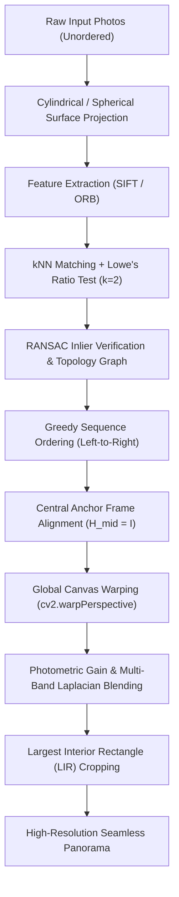

# 🌌 Panorama Reconstruction & Image Stitching System

[](https://www.python.org/)
[](https://opencv.org/)
[](https://streamlit.io/)
[](LICENSE)

An end-to-end, high-accuracy computer vision system for panoramic image stitching from multiple overlapping photographs. Designed for academic Image Processing & Computer Vision (IPCV) projects, research demos, and production pipelines.

---

## 🌟 Key Highlights

- **Multi-Algorithm Feature Detectors**: Supports **SIFT** (Scale-Invariant Feature Transform, DoG extrema), **ORB** (Oriented FAST and Rotated BRIEF), **AKAZE**, and **BRISK**.
- **Robust Correspondence Filtering**: Dual-nearest-neighbor **Lowe's Ratio Test** ($k=2$, $d_1/d_2 \le 0.75$) with RANSAC-driven outlier rejection.
- **Distortion-Free Projection**: **Cylindrical** and **Spherical** surface projection to map panning rotations into pure translations, eliminating wide-angle edge curvature.
- **Affine Similarity & Homography Alignment**: Prevents the classic "wedge/trumpet" vertical divergence by utilizing 4-DOF Similarity or 8-DOF Projective models.
- **Unordered / Shuffled Upload Resolution**: Graph-based adjacency walk reconstructs true spatial sequences even if photos are uploaded out-of-order.
- **Center-Anchored Transformation Chaining**: Fixes the sequence's median image as the reference frame ($H_{\text{mid}} = I$), balancing reprojection drift symmetrically.
- **Seamless Blending**: Burt-Adelson **Multi-Band Laplacian Pyramid** fusion and **Distance-Transform Alpha Feathering** with photometric gain compensation.
- **Automated Border Cropping**: Stack-based $O(W \cdot H)$ histogram dynamic programming to extract the **Largest Interior Rectangle (LIR)**.
- **Dual Interfaces**: Full-featured **Interactive Streamlit Web Studio** + headless **CLI**.

---

## 🏗️ System Architecture



---

## 📂 Repository Structure

```

panorama-stitching/
├── panorama/                         # Core Python package
│   ├── __init__.py                   # Package exports
│   ├── detector.py                   # SIFT, ORB, AKAZE, BRISK & rich keypoint drawing
│   ├── matcher.py                    # BFMatcher, FLANN, ratio test, dual-color inlier lines
│   ├── geometry.py                   # RANSAC Homography, Affine Partial 2D, Euclidean
│   ├── projection.py                 # Cylindrical & Spherical surface remaps
│   ├── sequencer.py                  # Adjacency graph walk & spatial ordering
│   ├── blending.py                   # Multi-band Laplacian, feathering, gain compensation
│   ├── cropping.py                   # Largest Interior Rectangle (LIR) & tight bbox
│   └── pipeline.py                   # PanoramaEngine high-level orchestrator
├── demo_images/                      # Included test image sequences
│   ├── scenic_city/                  # 4 real city photos (St. Petersburg)
│   └── architecture/                 # 4 synthetic multi-perspective photos
├── tests/                            # Automated unit test suite
│   ├── test_detector.py
│   ├── test_matcher.py
│   └── test_pipeline.py
├── app.py                            # Streamlit Web Application
├── cli.py                            # Command-Line Interface tool
├── THEORY_AND_VIVA_GUIDE.md          # Comprehensive IPCV Unit IV theory & viva Q&A
├── requirements.txt                  # Python dependencies
└── README.md
```

---

## ⚡ Quick Start

### 1. Installation

Clone the repository and install dependencies in an isolated virtual environment:

```bash
git clone https://github.com/Goyalkrishna1/panorama-stitching.git
cd panorama-stitching

python -m venv .venv
# On Windows:
.venv\Scripts\activate
# On Linux / macOS:
source .venv/bin/activate

pip install -r requirements.txt
```

### 2. Launch the Web Studio (Streamlit)

```bash
streamlit run app.py
```
Open your browser at `http://localhost:8501`. Features:
* 🏰 **1-Click Demo Datasets**: Instant test with Scenic City or Urban Architecture scenes.
* 🔬 **Keypoint Extractor Tab**: Inspect detected extrema with scale octave radii and orientation vectors.
* 🎯 **Pairwise Matching Tab**: Visualizes verified inliers (green) and rejected false matches (red).
* 🎞️ **Timeline Tab**: Follow each photo being warped onto the canvas step-by-step.
* 📐 **Math & Telemetry Tab**: Inspect calculated $3\times3$ homography matrices and export JSON diagnostics.

### 3. Command-Line Interface (CLI)

Run headless panorama stitching directly from your terminal:

```bash
# Basic run with SIFT and multi-band blending:
python cli.py --input demo_images/scenic_city --output output/panorama.jpg

# Fast binary stitching with ORB and alpha feathering:
python cli.py --input demo_images/architecture --detector ORB --blend feather --crop rect

# Custom field-of-view and projection:
python cli.py --input path/to/my_photos --projection cylindrical --fov 65 --crop tight
```

CLI Arguments Reference:
| Flag | Options | Default | Description |
|---|---|---|---|
| `-i, --input` | Directory or file pattern | *Required* | Input overlapping photos |
| `-o, --output` | File path | `output/stitched_panorama.png` | Output panorama path |
| `--detector` | `SIFT`, `ORB`, `AKAZE`, `BRISK` | `SIFT` | Feature detector algorithm |
| `--transform` | `affine`, `homography`, `euclidean` | `affine` | Transformation model |
| `--projection`| `cylindrical`, `spherical`, `planar` | `cylindrical` | Surface projection |
| `--fov` | Float (degrees) | `60.0` | Camera Field of View |
| `--blend` | `multiband`, `feather`, `simple` | `multiband` | Blending method |
| `--crop` | `rect`, `tight`, `none` | `rect` | Border cropping mode |

---

## 🧪 Automated Testing

Verify the complete test suite:

```bash
python -m unittest discover -s tests -v
```

All 5 core unit tests verify keypoint detection, descriptor extraction, ratio matching, RANSAC transformation estimation, and full pipeline execution.

---

## 📐 Mathematical Foundations (Unit IV IPCV)

### 1. Cylindrical Coordinate Mapping
Panning a camera around its optical axis introduces non-linear perspective warping. By projecting rays onto a virtual cylinder of radius $f = \frac{W}{2 \tan(\text{FOV}/2)}$:
$$
\theta = \frac{x_{\text{cyl}} - c_x}{f}, \quad h = \frac{y_{\text{cyl}} - c_y}{f}
$$
Backward mapping for interpolation:
$$
x_{\text{src}} = f \tan\theta + c_x, \quad y_{\text{src}} = \frac{y_{\text{cyl}} - c_y}{\cos\theta} + c_y
$$

### 2. Lowe's Ratio Test
For each query descriptor $d_i$, find the two nearest neighbors in the target set with Euclidean distances $D_1 \le D_2$:
$$
\frac{D_1}{D_2} < \tau \quad (\tau = 0.75)
$$
Rejects ambiguous matches originating from repetitive textures (foliage, bricks).

### 3. RANSAC Homography Estimation
Estimates the projective matrix $H \in \mathbb{R}^{3 \times 3}$ mapping coordinates $\mathbf{x} \leftrightarrow \mathbf{x}'$:
$$
\mathbf{x}' \sim \mathbf{H} \mathbf{x} \implies 
\begin{bmatrix} x' \\ y' \\ 1 \end{bmatrix} \sim
\begin{bmatrix} h_{11} & h_{12} & h_{13} \\ h_{21} & h_{22} & h_{23} \\ h_{31} & h_{32} & h_{33} \end{bmatrix}
\begin{bmatrix} x \\ y \\ 1 \end{bmatrix}
$$
Iteratively samples 4 point pairs (or 3 for Affine Similarity), scoring inliers whose Euclidean distance satisfies $\|\mathbf{x}' - \frac{H\mathbf{x}}{(H\mathbf{x})_z}\| < \epsilon_{\text{RANSAC}}$.

### 4. Burt-Adelson Multi-Band Laplacian Pyramid
Decomposes each warped layer $I$ into frequency octaves:
$$
L_k = G_k - \text{pyrUp}(\text{pyrDown}(G_k))
$$
Blends each frequency band independently using Gaussian-blurred spatial masks, preserving sharp textural detail while seamlessly harmonizing low-frequency illumination gradients.

---

## 📄 License
This project is open-source under the [MIT License](LICENSE).
